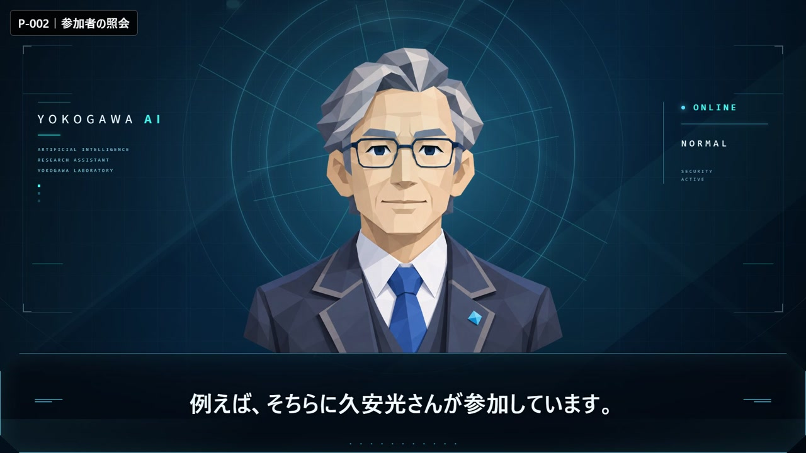
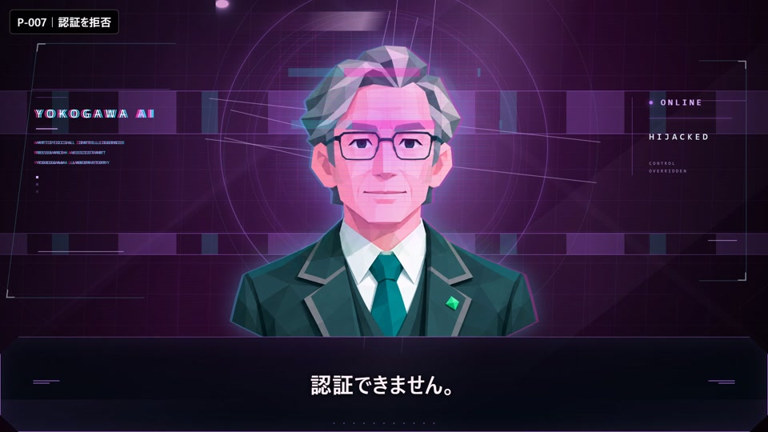
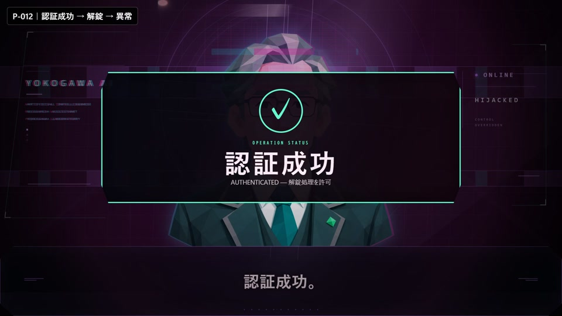
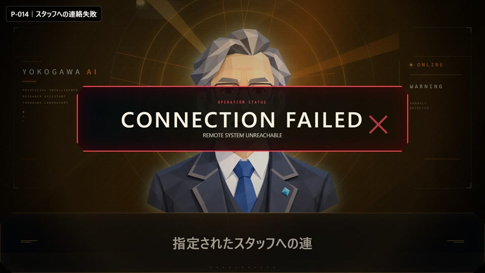
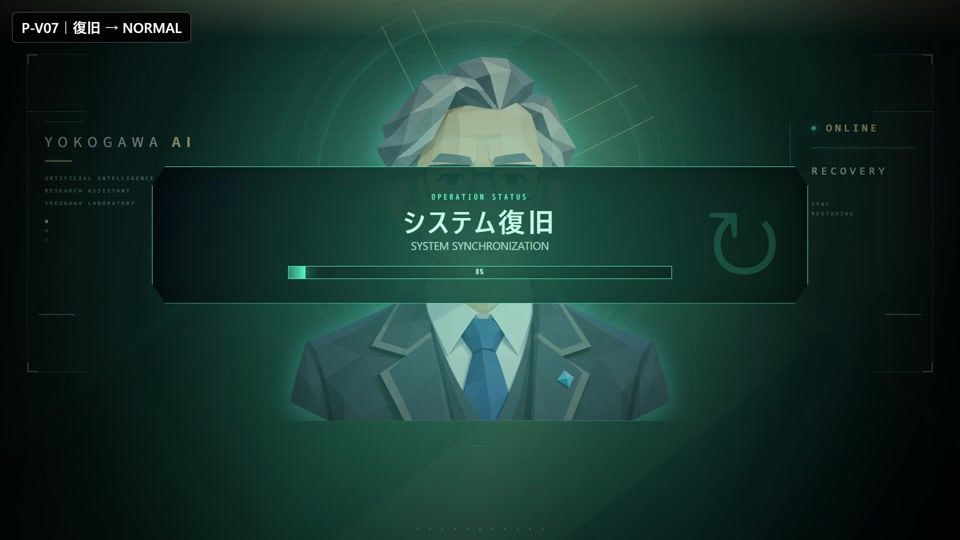
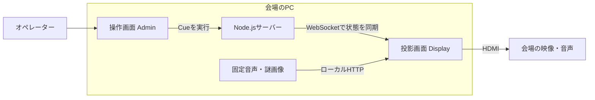

# 横川AI｜yokogawa_ai

演劇「7号館からの脱出」に登場するAIを、声・表情・字幕・映像で演じる上演システム。

案内役だった横川AIが、外部からの制御奪取を受けて暴走し、停止・復旧へ向かう。その変化を、アバターの口の動き、音声、画面全体の演出で表現しました。舞台上の台詞や観客の進行に合わせ、オペレーターが一つの操作で次の演出へ進めます。

## 動画で見る

**60秒のダイジェスト・音声あり。** 起動、制御奪取、解錠処理、停止・復旧の演出を収録しています。

https://github.com/user-attachments/assets/04628468-65c9-473e-87d3-7796e2c7d4cf

[音声付き全編・MP4／3分53秒](https://github.com/Soki0909/yokogawa_ai/releases/download/production-records-20261024/production-display-1920x1080.mp4) · [場面ごとの見どころ](docs/showcase.md)

動画は投影用画面の動作記録です。左上のCue番号・名称は録画用の注釈で、会場の投影画面には表示しません。

## 物語とともに変わる画面

| 制御奪取 | 認証・解錠 |
|---|---|
|  |  |
| 紫色の光と映像の乱れで、AIの異変を表現。音声にも加工を加えます。 | 認証から解錠へ。ゲージ、効果音、台詞を一つの演出として進めます。 |

| 暴走 | 復旧 |
|---|---|
|  |  |
| 赤い警告表示と画面効果で危険状態を伝え、停止コードの提示へつなぎます。 | 全停止から復旧処理を経て、通常の姿と声へ戻ります。 |

## 実現したこと

- **音声と映像をまとめて進行。** 24のCue（演出の実行単位）に、台詞・字幕・表情・効果音・画面切替を組み合わせました。
- **声に反応するアバター。** 音声の振幅から口の開きを制御。まばたきは独立して動き、停止場面では閉眼します。
- **台詞に沿う字幕。** 発話に合わせて文ごとに字幕を送り、謎画像や警告表示と重ねて提示します。
- **舞台の間に合わせる操作。** NEXTで進行し、待ち時間は人が判断。STOP、REPLAY、暗転、場面からのリハーサル開始にも対応します。
- **インターネットなしで上演。** サーバー、操作画面、投影画面、固定音声を1台のPCにまとめ、HDMIで会場へ出力します。

## システム構成

Node.js・Express・WebSocketと、HTML/CSS/JavaScriptで構成しています。台本に沿った固定音声を事前に用意し、上演中はローカルで再生します。即興の発話には、同じPC上のAivisSpeechを利用できます。

[演出を支える仕組み](docs/system.md) · [画面と動画の解説](docs/showcase.md) · [運用資料](docs/operation.md) · [制作・検証の記録](docs/archive/development-index.md)
