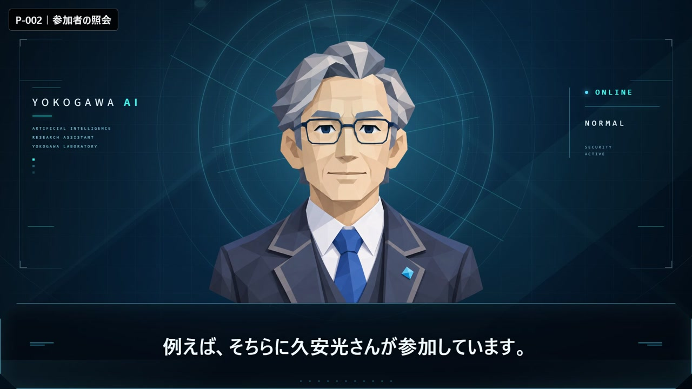
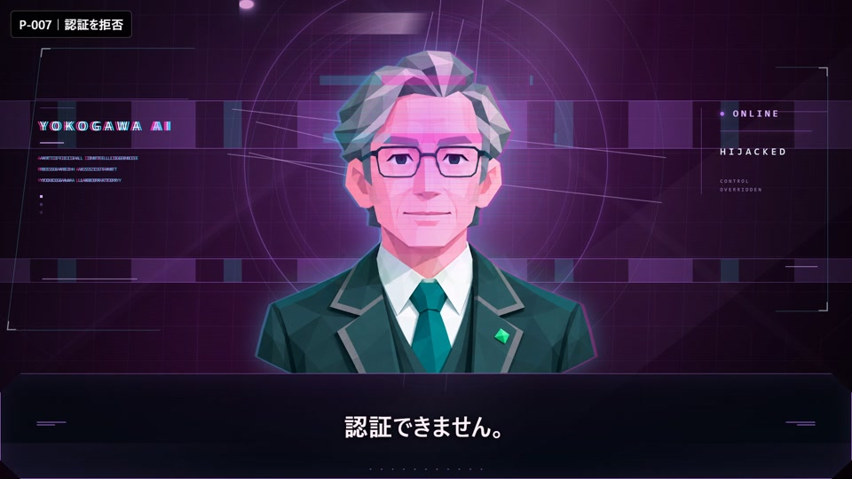
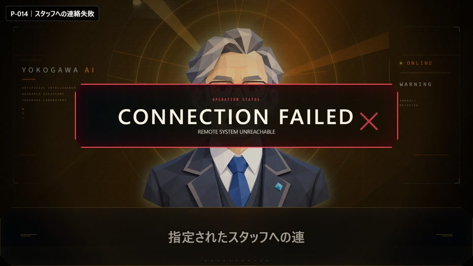
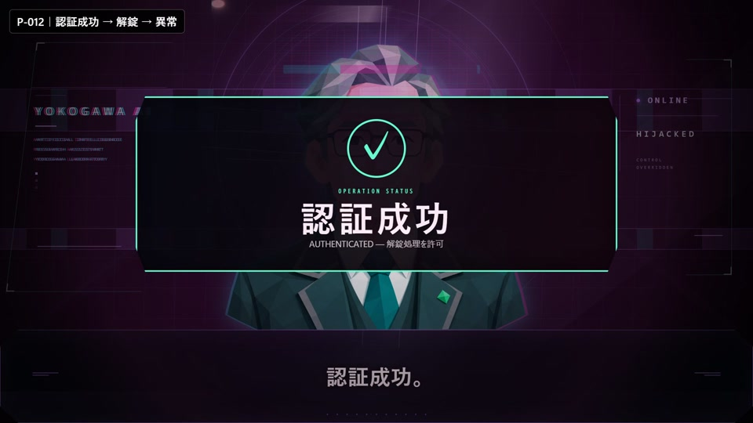
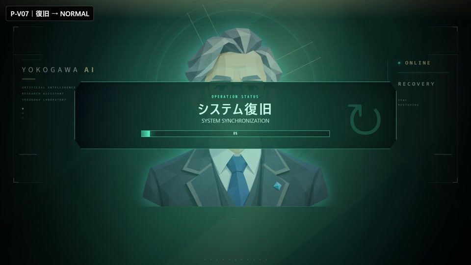

# 横川AIの演出

横川AIは、観客を案内する穏やかな姿から、制御を奪われた状態、暴走、停止・復旧へと変化します。声と画面を同時に変えることで、物語の転換を客席へ伝えます。

## 動画

https://github.com/user-attachments/assets/04628468-65c9-473e-87d3-7796e2c7d4cf

60秒のダイジェストは、元の動作記録から四つの場面を抜き出したものです。場面内の速度と音声はそのままに、待ち時間や中間の台詞を省いています。

| ダイジェスト内の位置 | 見どころ |
|---|---|
| 0:00〜0:10 | 起動。アバター、声、字幕が一体になって応答する |
| 0:10〜0:24 | 画面が乱れ、紫色の制御奪取状態へ変化する |
| 0:24〜0:38 | 認証と解錠。複数ゲージと効果音が進行を示す |
| 0:38〜1:00 | 全停止、復旧処理、通常画面への復帰 |

[音声付き全編・1920×1080／3分53秒／約61MB](https://github.com/Soki0909/yokogawa_ai/releases/download/production-records-20261024/production-display-1920x1080.mp4)

録画では演出の確認のために順次Cueを実行しています。上演時は演者の台詞や観客の進行を待ち、オペレーターが次のCueを実行します。左上のCue注釈は録画時だけの表示です。

## 声を持つ案内役

中央のアバターと画面下の字幕を軸に、周囲のリングや光でAIの状態を表現します。口は音声の大きさに応じて開閉し、まばたきは独立して動きます。台詞は事前に制作した音声を使い、同じ発音・間で再生できます。

## 制御奪取と暴走

| 制御奪取 | 暴走 |
|---|---|
|  |  |

通常の青色から紫色へ移り、映像の分断やずれを加えます。暴走では赤い警告、破断したリング、中央のメッセージで状態の悪化を示します。字幕は画面効果から独立させ、台詞を読み取れる位置に保ちます。

## 解錠と復旧

| 解錠処理 | 復旧後 |
|---|---|
|  |  |

ゲージの進行、効果音、字幕、画面の変化をCue内の時間に沿って動かします。停止場面ではアバターが目を閉じ、画面の動きも停止。復旧場面では走査やゲージの演出を経て、通常画面に戻ります。

[仕組みを読む](system.md) · [作品紹介に戻る](../README.md)
