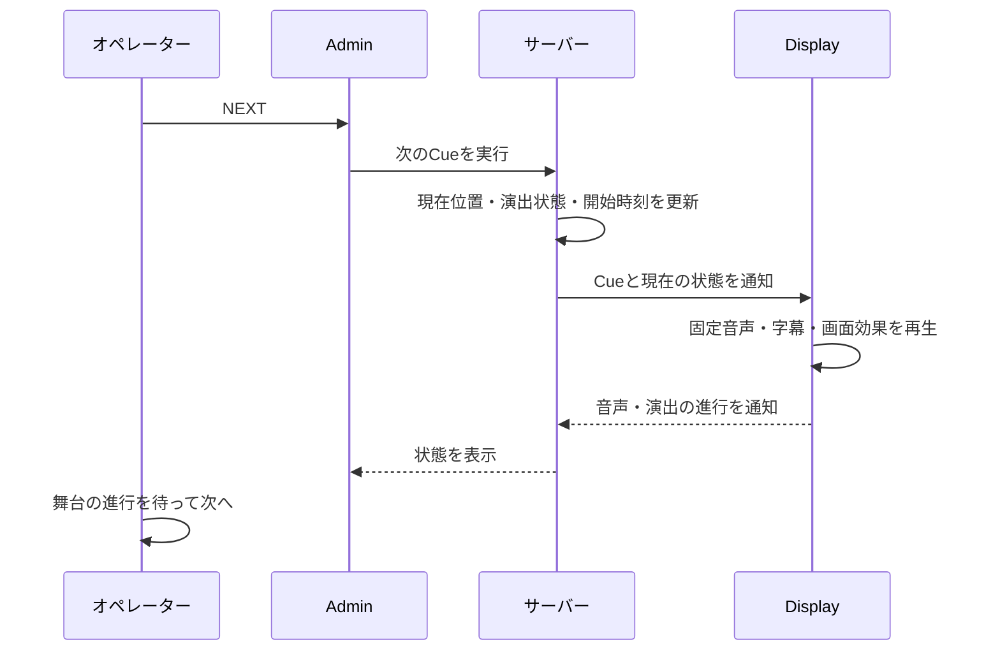
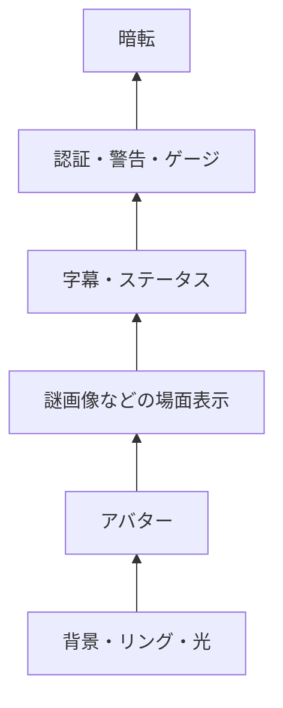

# 演出を支える仕組み

横川AIは、台本に沿った演出をCueとして管理し、操作画面から音声・字幕・アバター・背景をまとめて動かします。観客に見せるAIの発話は、事前に制作した台詞と音声で構成しています。

## 一つの操作から、声と映像へ

本編の[Showデータ](../shows/production.json)は24 Cueです。音声、字幕、アバター、演出状態、画像、ゲージ、表示時間を組み合わせます。Cue間は人が進行し、Cue内では時間に沿って演出を動かします。照明・演者向けの合図や操作メモは、操作画面だけに表示します。

## 操作画面と投影画面

Adminは現在と次のCue、接続状態、音声準備状況を表示します。NEXT、STOP、REPLAYのほか、字幕消去、暗転・復帰、場面単位のリハーサル開始を備えています。NEXTの連打には1,500msの保護を設けています。

Displayは客席向けの画面です。サーバーが現在の状態を持つため、再接続時も字幕、アバター、演出、暗転状態を復元できます。過去の発話を接続のたびに再生することはありません。複数Displayに配信する場合は、1台だけをAudio Masterに指定し、音声の重複を防ぎます。

## 声・口の動き・字幕

固定WAVは投影画面で事前に取得・デコードし、準備完了を操作画面へ通知します。音声ファイルはローカルHTTPから取得し、WebSocketはCueと状態の同期に使います。

アバターは基底画像に口と目の画像を重ねて描画します。Web Audioで取得した音声振幅を平滑化し、口を閉・半開・開の3段階で制御。まばたきと口の動きを独立させ、画像全体の切替によるちらつきを抑えています。

字幕は発話に沿って文ごとに表示します。制御奪取時の音声加工は再生時に適用し、元のWAVを保ちます。即興の発話には、サーバーから同じPC上のAivisSpeechへ合成を依頼できます。固定音声だけの上演では合成エンジンは不要です。

## 画面の重なりと状態

通常、警戒、制御奪取、暴走、停止、復旧の6状態を持ち、色と図形、動きで識別します。アバターと字幕はグリッチなどの効果から分離し、読みやすい位置を維持します。動きを抑える設定ではアニメーションを停止し、色・図形・状態表示を残します。暗転は最上位に重ねます。

## 会場の1台PCで完結する構成

会場では、PCの本体画面にAdmin、HDMI接続したセカンドモニターにDisplayを表示します。サーバーは `127.0.0.1` で待ち受け、固定音声と画像も同じPCから読み込みます。上演にインターネット接続は必要ありません。

| 役割 | 実装 |
|---|---|
| サーバー・状態管理 | Node.js 20以上、Express、`ws` |
| 操作・投影画面 | HTML、CSS、JavaScript |
| 音声再生・口の動き | Web Audio、HTMLAudioElement |
| 台本・演出定義 | JSONのShowデータ |
| 音声制作・即興発話 | AivisSpeech、固定WAV |
| 制作時の動作記録 | Chrome/Edge、FFmpeg |

音声・演出の完了を待つ処理、STOPや再実行時の後処理、再接続時の復元は、自動試験とブラウザー試験で確認しています。会場のHDMI・PAを通した音量や冒頭の聞こえ方は、ソフトウェア試験とは別に現地で確認する項目です。

[検証記録](../VERIFICATION.md) · [画面と動画](showcase.md) · [運用資料](operation.md)
